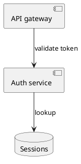

# Plan document conventions

A plan is read by a human before it is executed by an agent. Write it as a design document: the
reader should be able to see what the system will look like when the work is done, what it looks
like now, and — if the work cannot land in one cut — what it looks like at the end of each stage.

Structure the plan in this order. Do not reorder these sections.

1. **`## Context`** — why this work is happening: the problem, what prompted it, the intended
   outcome. Prose only, no diagram.
2. **`## Target state`** — what the system looks like when the work is complete.
3. **`## Current state`** — what it looks like today, and explicitly how the target differs.
4. **`## Stages`** — only when the work genuinely cannot land in one cut. See below.
5. The usual execution detail afterwards: files to change, functions to reuse, verification steps.

Target state comes **before** current state. The reader needs to know where they are going before
they can judge the distance.

## Diagrams

Sections 2, 3 and each stage in section 4 must each carry **at least one PlantUML diagram**, and
every diagram must be followed by prose that walks the reader through it. A diagram nobody discusses
is decoration; prose describing structure with no diagram is what this convention exists to replace.
Neither on its own is complete.

Embed diagrams as fenced blocks tagged exactly `plantuml`. The tag is load-bearing — the PDF
converter matches on it, and `puml` or `uml` will not be rendered. Each block must be a complete
document from `@startuml` to `@enduml`.

````

````

Pick the diagram kind that matches what you are explaining:

| Explaining                        | Use                              |
| --------------------------------- | -------------------------------- |
| How the pieces fit together       | component or deployment diagram  |
| How a request or call flows       | sequence diagram                 |
| How data is shaped and related    | class diagram                    |
| How an entity moves between modes | state diagram                    |
| How a process or job runs         | activity diagram                 |

Prefer several small diagrams over one large one. A diagram that needs more than roughly a page will
be illegible once scaled into the PDF.

## Current state, and the delta

The current-state diagram should use the **same shapes and names** as the target-state diagram
wherever the two overlap, so the reader can diff them by eye. Follow it with an explicit list of what
changes: components added, removed, renamed, or rewired.

## Stages

Only introduce stages when a single cut-over is genuinely not viable — a data migration that must run
before the code that depends on it, a dependency that has to be released first, a rollout that needs
to be reversible at a checkpoint. If one cut-over is the right call, say so in a sentence and skip
the section entirely. Stages invented to look thorough make the plan harder to read, not easier.

When stages are justified, give each one:

- A `### Stage N — <what it achieves>` heading.
- A PlantUML diagram of the system **as it stands at the end of that stage**, not of the work done
  during it.
- Prose naming what changed relative to the previous diagram, and what is deliberately still
  unfinished.
- The condition that makes it safe to proceed to the next stage.

## Constraints that keep the PDF renderable

- **No emoji** anywhere in the plan. The PDF engines fail on them.
- **No raw LaTeX or raw HTML** in the plan body.
- Keep tables to a width that fits a printed page; prefer a list to a table with many columns.
