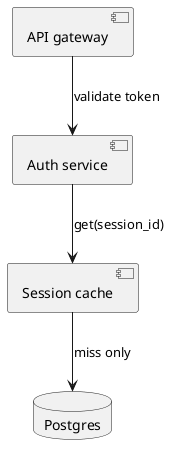
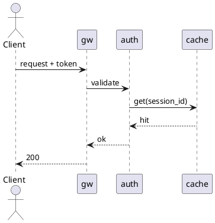
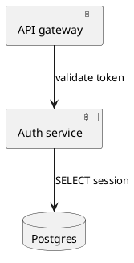
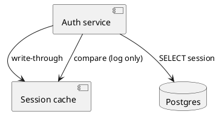
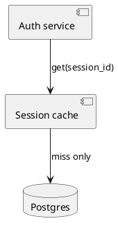

# Example plan: session store behind a cache

## Context

This file is a fixture for testing the `planning` plugin's Markdown-to-PDF conversion. It is written
to follow `contexts/plan-document-conventions.md` exactly, so a successful render also demonstrates
what a conforming plan looks like. The scenario is invented; nothing here describes real code.

## Target state

Session lookups are served from an in-memory cache in front of the database, so the auth service
stops hitting Postgres on every authenticated request.

The auth service no longer talks to Postgres directly. Every read goes through the session cache,
which owns the only connection to the sessions table and falls through to Postgres on a miss. Writes
go to Postgres and invalidate the cached entry, so a revoked session cannot outlive its revocation.

The hot path is three hops and never reaches the database. The miss path adds one Postgres round trip
and a cache fill before returning, which is the same latency the system has today.

## Current state

Every validation is a database read.

The difference from the target is one added component and one rewired edge: the session cache is
new, and the `auth -> db` edge becomes `auth -> cache -> db`. No component is removed, and the
gateway is untouched.

## Stages

Two stages are justified here because the cache must be observably correct before it becomes
authoritative — a single cut-over would put an unproven cache on the critical path.

### Stage 1 — cache populated but not trusted

Relative to the current state, the cache exists and is filled on every read, but the answer still
comes from Postgres. Each lookup compares the two results and logs any disagreement. Deliberately
unfinished: the cache serves no traffic.

Proceed when the disagreement rate is zero over a full day of production traffic.

### Stage 2 — cache authoritative

The comparison path and the direct `auth -> db` read are both removed; the cache now answers and
falls through on a miss. This is the target state.

## Verification

Run the auth service's integration suite against a seeded cache, then revoke a session and assert the
next validation fails within one second.
